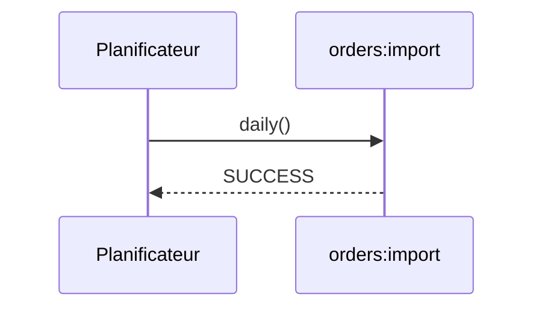

## Summary

Lance `orders:import` chaque jour, par le planificateur de `routes/console.php`.

## Preconditions

Un cron lance `schedule:run` chaque minute.

## Journey

## Decisions

—

## Data

Celles de `orders:import`.

## Cross-cutting mechanisms

Aucun.

## Points of attention

Sans cron sur le serveur, la tâche ne s'exécute jamais, sans erreur.

## Change

rédaction initiale
