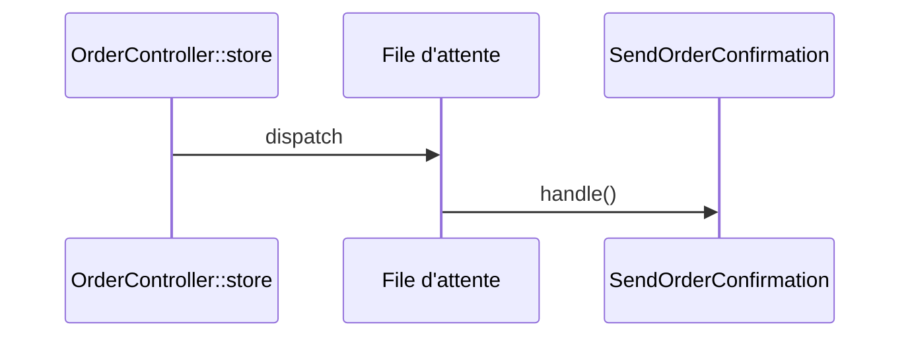

## Summary

Envoie la confirmation d'une commande, en file d'attente.

## Preconditions

Un worker `queue:work` tourne.

## Journey

## Decisions

—

## Data

Recharge l'`Order` sérialisée par son identifiant.

## Cross-cutting mechanisms

Aucun.

## Points of attention

`handle()` est vide : aucune confirmation n'est encore envoyée.

## Change

rédaction initiale
