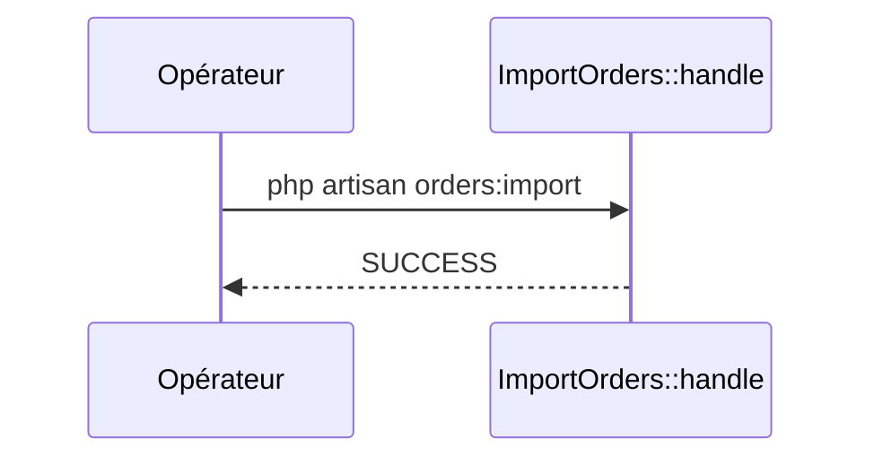

## Summary

Importe les commandes d'un export CSV ; le fichier est facultatif.

## Preconditions

—

## Journey

## Decisions

—

## Data

Compte les `Order` existantes ; n'écrit encore rien.

## Cross-cutting mechanisms

Aucun.

## Points of attention

L'import n'est pas écrit : la commande se contente de compter les commandes.

## Change

rédaction initiale
