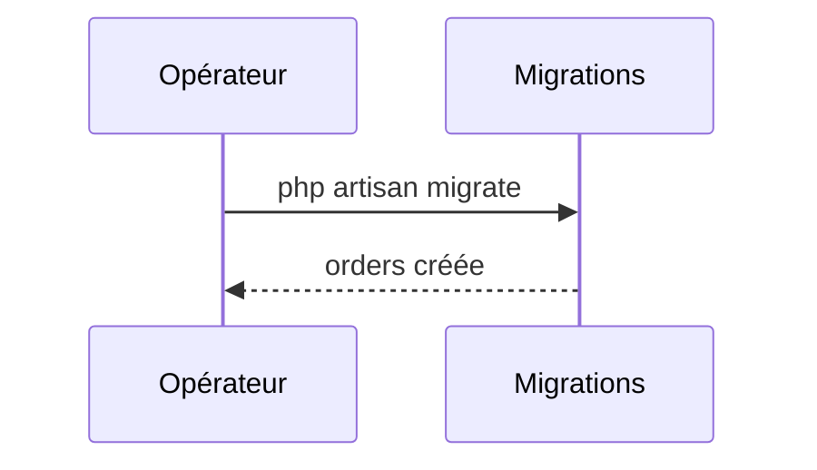

## Summary

Crée la table `orders` : identifiant, référence de 32 caractères, horodatages.

## Preconditions

—

## Journey

## Decisions

—

## Data

Schéma de `orders`.

## Cross-cutting mechanisms

Aucun.

## Points of attention

Aucune méthode `down()` : la migration ne se défait pas.

## Change

rédaction initiale
