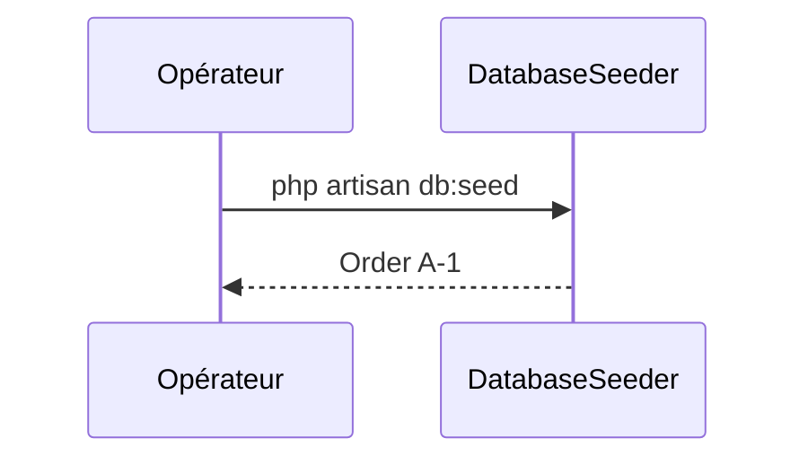

## Summary

Peuple la base avec une commande d'exemple, `A-1`.

## Preconditions

Les migrations sont passées.

## Journey

## Decisions

—

## Data

Écrit une `Order`.

## Cross-cutting mechanisms

Aucun.

## Points of attention

Relancé, il crée une seconde commande `A-1`.

## Change

rédaction initiale
