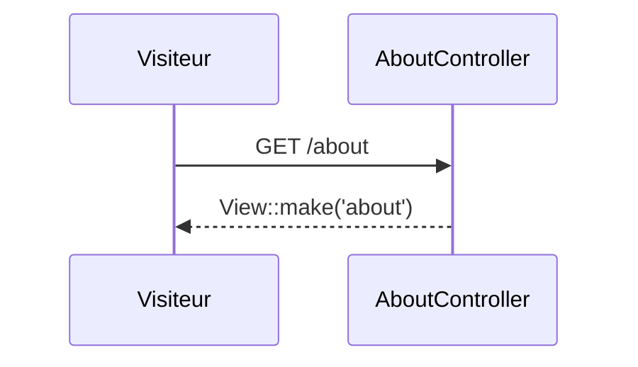

## Summary

Page « À propos », statique, rendue par un contrôleur invocable.

## Preconditions

—

## Journey

## Decisions

—

## Data

Aucune.

## Cross-cutting mechanisms

Groupe `web`.

## Points of attention

La route n'a pas de nom : son identifiant vient de sa méthode et de son URI, et changera avec elle.

## Change

rédaction initiale
