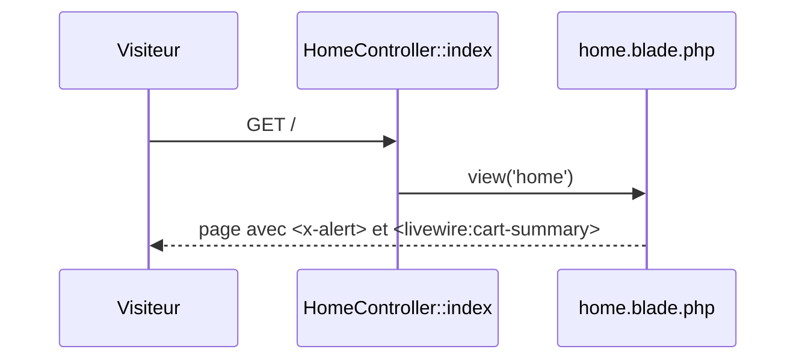

## Summary

Page d'accueil : un message d'information, le résumé du panier et un lien vers les commandes.

## Preconditions

—

## Journey

## Decisions

—

## Data

Aucune.

## Cross-cutting mechanisms

Le groupe `web` (session, cookies, CSRF) s'applique comme à toute route de `routes/web.php`.

## Points of attention

Le panier est un composant Livewire : il se rafraîchit seul, sans recharger la page.

## Change

rédaction initiale
