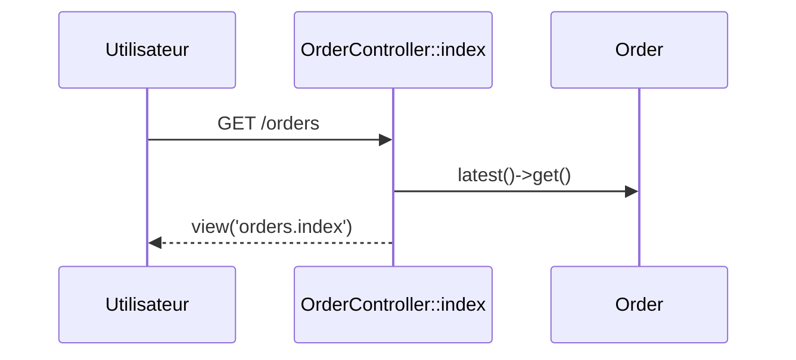

## Summary

Liste des commandes, des plus récentes aux plus anciennes, avec un formulaire de création.

## Preconditions

Être connecté (`auth`).

## Journey

## Decisions

—

## Data

Lit toutes les `Order`, sans pagination.

## Cross-cutting mechanisms

`auth` redirige un visiteur non connecté vers la connexion.

## Points of attention

Sans pagination, la page grossit avec la table `orders`.

## Change

rédaction initiale
