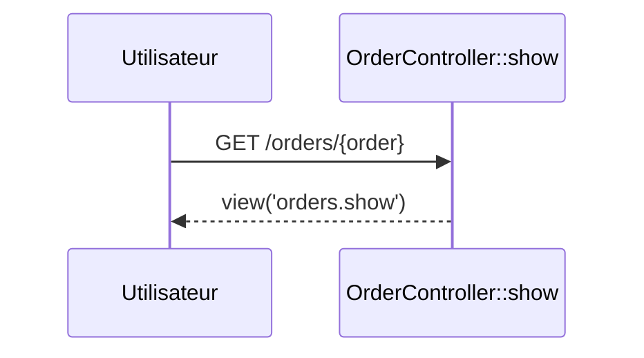

## Summary

Affiche une commande, retrouvée par sa clé grâce à la liaison de modèle de la route.

## Preconditions

Être connecté et autorisé par `OrderPolicy::view`.

## Journey

## Decisions

—

## Data

Lit une `Order`.

## Cross-cutting mechanisms

`can:view,order` consulte `OrderPolicy::view` avec la commande liée.

## Points of attention

Une clé inconnue répond 404 avant même le contrôleur.

## Change

rédaction initiale
