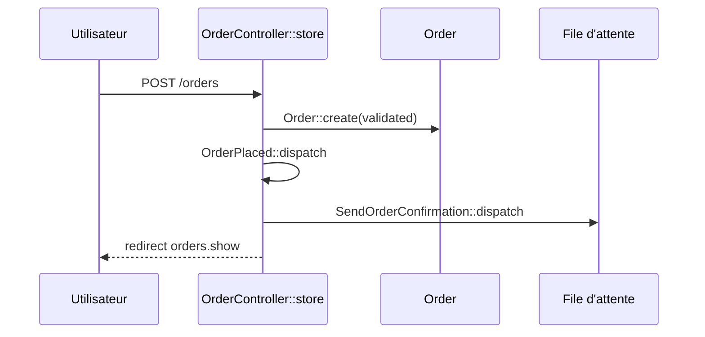

## Summary

Crée une commande à partir de sa référence, annonce `OrderPlaced` et met en file l'envoi de la confirmation.

## Preconditions

Être connecté et autorisé par `OrderPolicy::create`.

## Journey

## Decisions

—

## Data

Écrit une `Order` ; la référence est obligatoire, 32 caractères au plus.

## Cross-cutting mechanisms

`NotifyWarehouse` écoute `OrderPlaced` et s'exécute pendant la requête, avant la redirection.

## Points of attention

Une référence invalide renvoie au formulaire avec les erreurs, sans rien écrire.

## Change

rédaction initiale
