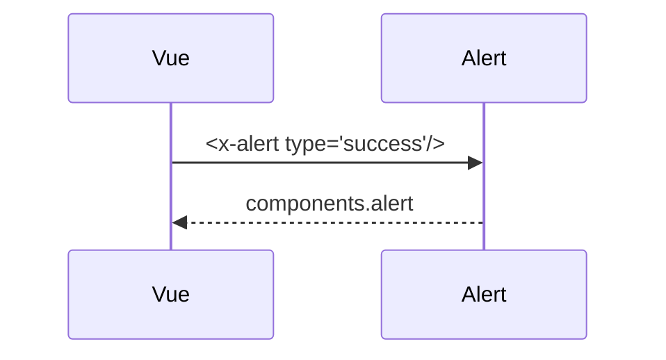

## Summary

Composant Blade d'alerte, typé (`info` par défaut).

## Preconditions

—

## Journey

## Decisions

—

## Data

Aucune.

## Cross-cutting mechanisms

Aucun.

## Points of attention

Le contenu vient du slot : une alerte sans contenu reste vide.

## Change

rédaction initiale
