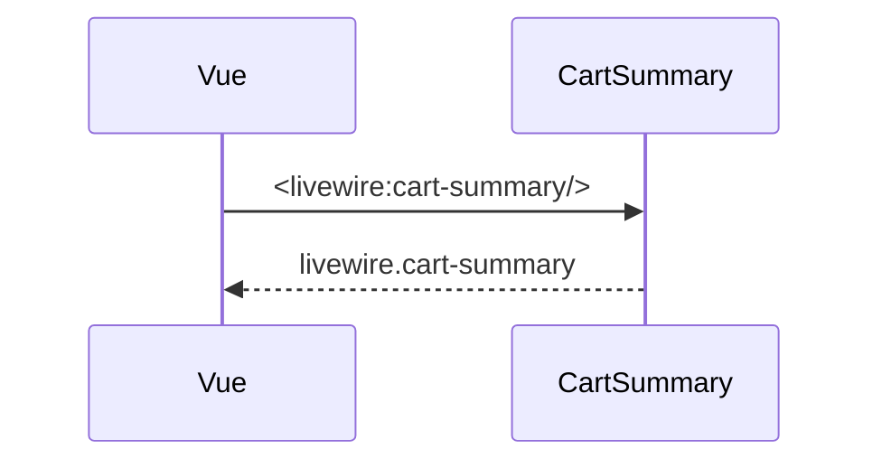

## Summary

Composant Livewire qui affiche le nombre d'articles du panier.

## Preconditions

—

## Journey

## Decisions

—

## Data

Aucune : `items` vaut 0.

## Cross-cutting mechanisms

Les requêtes Livewire passent par la route `livewire/update` du paquet.

## Points of attention

Le compteur ne lit aucun panier réel.

## Change

rédaction initiale
