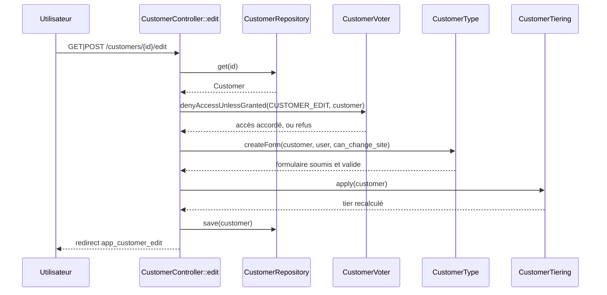
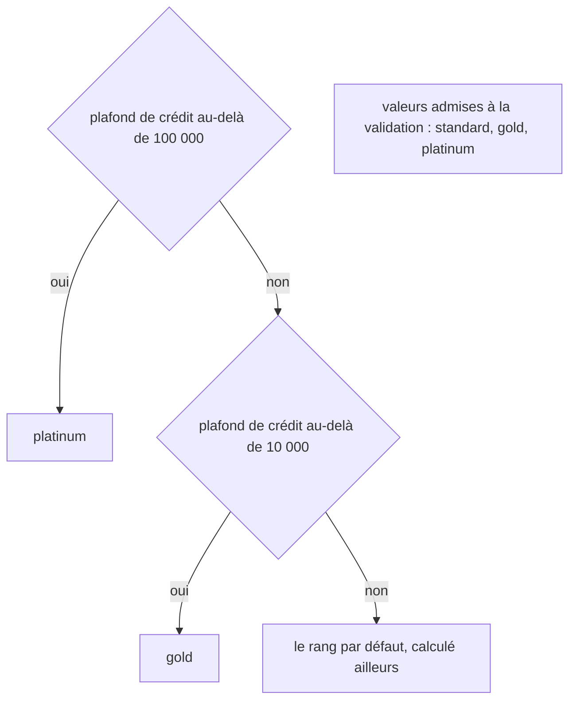
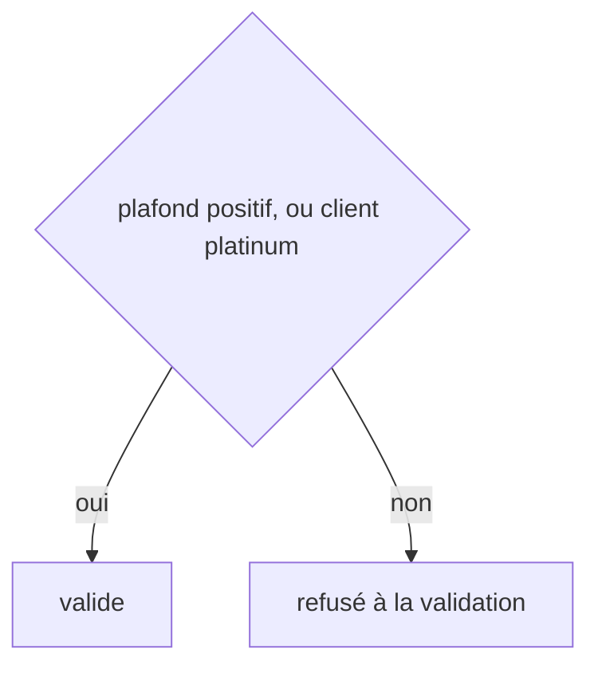
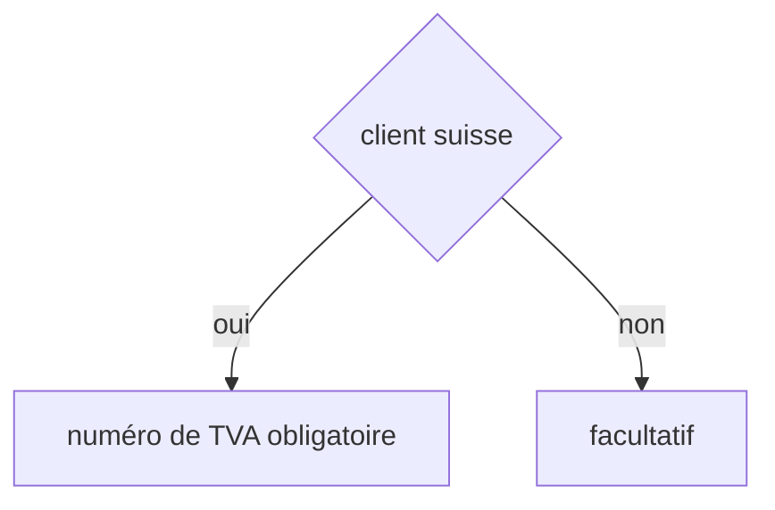
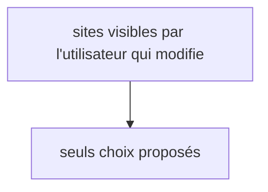
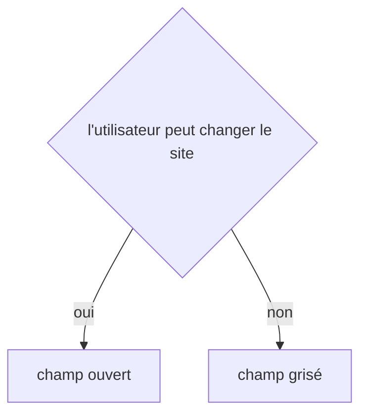

## Summary

Modifie la fiche d'un client : son nom et son site de rattachement, puis recalcule son rang à
l'enregistrement. L'écran n'est ouvert qu'à qui peut modifier ce client, et les sites proposés dépendent
de qui le modifie.

## Preconditions

Utilisateur connecté (ROLE_USER) autorisé par le voter sur ce client.

## Journey

## Decisions

**`App\Entity\Customer::tier`**

**`App\Entity\Customer::creditLimit`**

**`App\Entity\Customer::vatNumber`**

**`App\Entity\Customer::site`**

**`App\Form\CustomerType::site.disabled`**

## Data

Lit et écrit un `Customer` via `src/Repository/CustomerRepository.php` ; lit les sites proposés via
`src/Repository/SiteRepository.php`.

## Cross-cutting mechanisms

Le voter `CustomerVoter` décide l'accès : refusé sans utilisateur connecté, accordé à un manager, sinon
accordé seulement au gestionnaire de compte du client. La locale de la requête est fixée par
`LocaleListener` avant le contrôleur.

## Points of attention

Le rang par défaut est décidé par `defaultTier()`, que le schéma ne détaille pas : le calcul est un appel
plus loin. Les sites proposés ne sont filtrés que par l'utilisateur passé en option : un appel sans cette
option n'en propose aucun.

## Change

rédaction initiale
