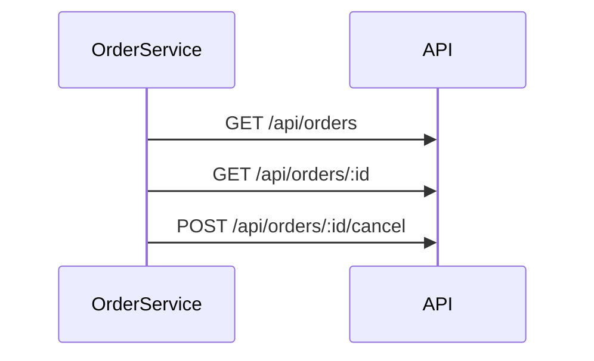

# OrderService
`integration.order-service` · type: integrations · last updated: 2026-09-16 · commit: e40e7e1

## Summary

Client HTTP des commandes : liste, détail et annulation.

## Trigger

| Element | Value |
|---|---|
| Entry point | `order-service` (http-client) |
| Endpoints | `GET /api/orders, GET /api/orders/:param, POST /api/orders/:param/cancel` |
| Security | — |
| Preconditions | — |

## Journey

## Decisions

—

## Data

Les commandes de l'API, sous `environment.apiUrl`.

## Cross-cutting mechanisms

Aucun intercepteur.

## Points of attention

Les observables sont froids : sans abonnement, rien n'est envoyé.

## Related workflows

—

## History

| Date | Commit | Change |
|---|---|---|
| 2026-09-16 | e40e7e1 | rédaction initiale |
