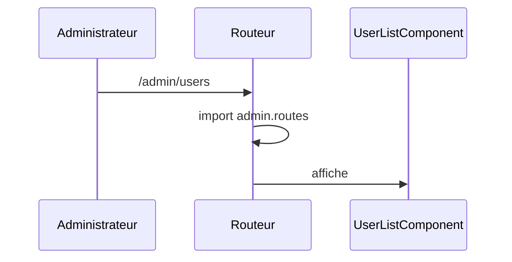

# /admin/users
`route.admin.users` · type: routes · last updated: 2026-09-16 · commit: e40e7e1

## Summary

Liste des utilisateurs, chargée paresseusement avec les routes d'administration.

## Trigger

| Element | Value |
|---|---|
| Entry point | `/admin/users` (`admin.users`) |
| Security | `authGuard` |
| Preconditions | Être connecté : `canMatch` empêche même le chargement du module. |

## Journey

## Decisions

**Navigation**

<!-- Above: drawn by DevTools from the code. Below: written by Claude. -->

## Data

Aucune.

## Cross-cutting mechanisms

`authGuard` en `canMatch` : sans connexion, la table d'administration n'est jamais téléchargée.

## Points of attention

Hors ligne, le premier accès échoue : le morceau de code n'est pas encore chargé.

## Related workflows

- [`route.orders`](orders.md) — navigation

## History

| Date | Commit | Change |
|---|---|---|
| 2026-09-16 | e40e7e1 | rédaction initiale |
