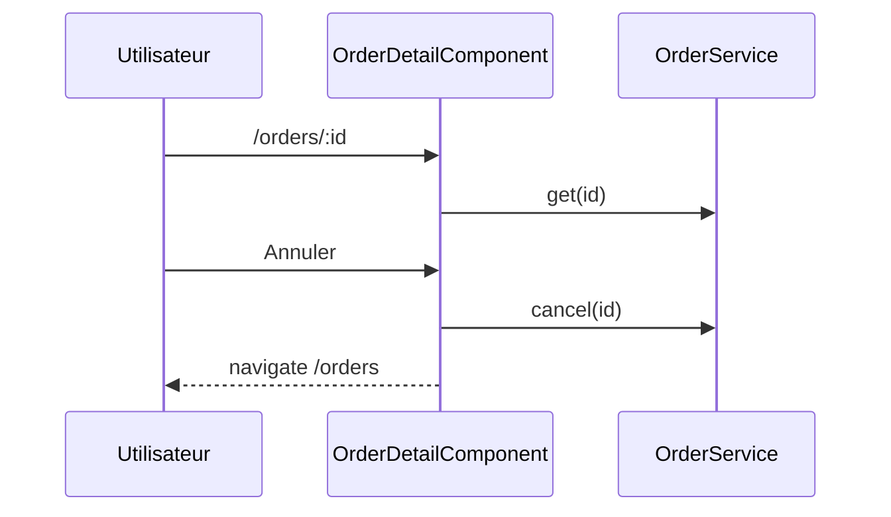
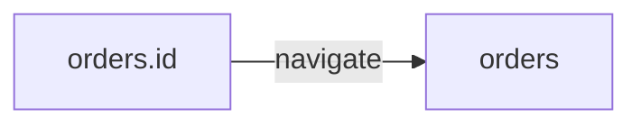

# /orders/:id
`route.orders.id` · type: routes · last updated: 2026-09-16 · commit: e40e7e1

## Summary

Détail d'une commande et son annulation, après laquelle l'écran revient à la liste.

## Trigger

| Element | Value |
|---|---|
| Entry point | `/orders/:id` (`orders.id`) |
| Security | `authGuard` |
| Preconditions | Être connecté (`authGuard`). |

## Journey

## Decisions

**Navigation**

<!-- Above: drawn by DevTools from the code. Below: written by Claude. -->

## Data

Lit une commande, l'annule par l'API.

## Cross-cutting mechanisms

`authGuard`, hérité de la route parente.

## Points of attention

L'annulation n'est pas confirmée : un clic suffit.

## Related workflows

- [`route.orders`](orders.md) — navigation

## History

| Date | Commit | Change |
|---|---|---|
| 2026-09-16 | e40e7e1 | rédaction initiale |
