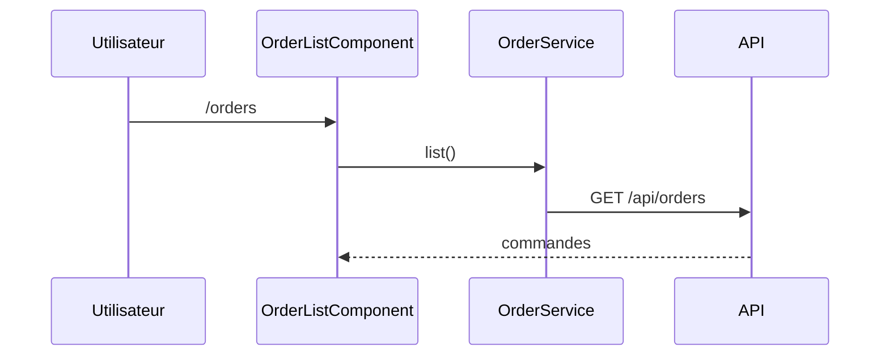
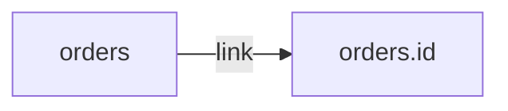

# /orders
`route.orders` · type: routes · last updated: 2026-09-16 · commit: e40e7e1

## Summary

Liste des commandes, chacune avec son statut, chargée depuis l'API.

## Trigger

| Element | Value |
|---|---|
| Entry point | `/orders` (`orders`) |
| Security | `authGuard` |
| Preconditions | Être connecté (`authGuard`). |

## Journey

## Decisions

**Navigation**

<!-- Above: drawn by DevTools from the code. Below: written by Claude. -->

## Data

Lit les commandes de l'API.

## Cross-cutting mechanisms

`authGuard`, hérité de la route parente `orders`.

## Points of attention

Le badge de statut est partagé avec le détail : le modifier change les deux écrans.

## Related workflows

- [`route.orders.id`](orders.id.md) — navigation

## History

| Date | Commit | Change |
|---|---|---|
| 2026-09-16 | e40e7e1 | rédaction initiale |
