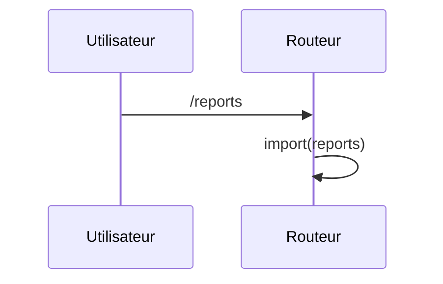

# /reports
`route.reports` · type: routes · last updated: 2026-09-16 · commit: e40e7e1

## Summary

Écran des rapports, chargé depuis un chemin calculé.

## Trigger

| Element | Value |
|---|---|
| Entry point | `/reports` (`reports`) |
| Security | — |
| Preconditions | — |

## Journey

## Decisions

—

## Data

Aucune.

## Cross-cutting mechanisms

Aucun garde.

## Points of attention

Le chemin du composant est une variable : DevTools ne peut pas dire quel fichier sert l'écran.

## Related workflows

—

## History

| Date | Commit | Change |
|---|---|---|
| 2026-09-16 | e40e7e1 | rédaction initiale |
