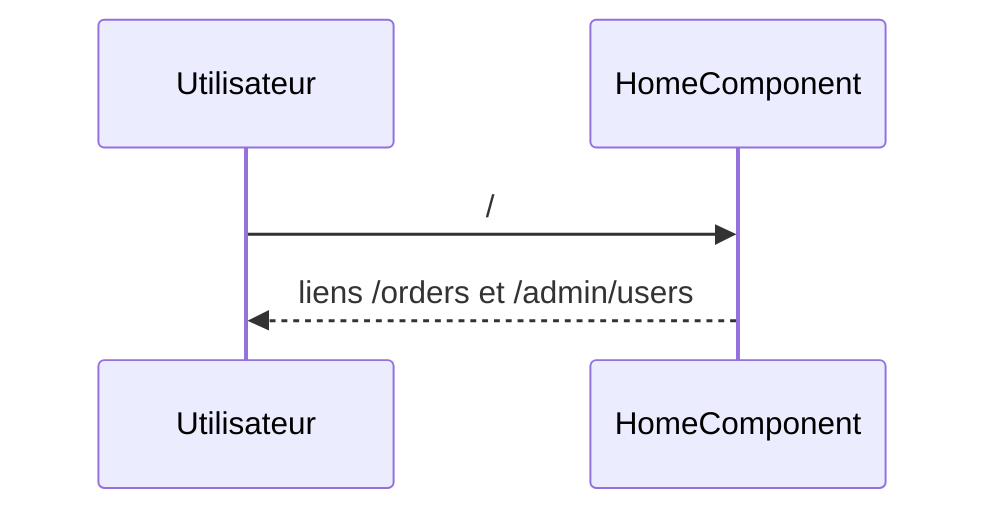
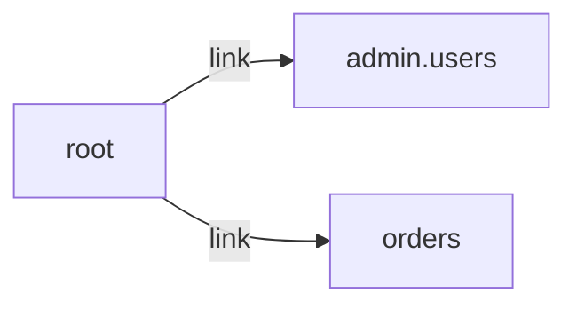

# /
`route.root` · type: routes · last updated: 2026-09-16 · commit: e40e7e1

## Summary

Écran d'accueil : deux liens, vers les commandes et vers les utilisateurs.

## Trigger

| Element | Value |
|---|---|
| Entry point | `/` (`root`) |
| Security | — |
| Preconditions | — |

## Journey

## Decisions

**Navigation**

<!-- Above: drawn by DevTools from the code. Below: written by Claude. -->

## Data

Aucune.

## Cross-cutting mechanisms

Aucun garde : l'accueil est public.

## Points of attention

Les liens mènent à des écrans gardés : un visiteur non connecté revient ici.

## Related workflows

- [`route.admin.users`](admin.users.md) — navigation
- [`route.orders`](orders.md) — navigation

## History

| Date | Commit | Change |
|---|---|---|
| 2026-09-16 | e40e7e1 | rédaction initiale |
