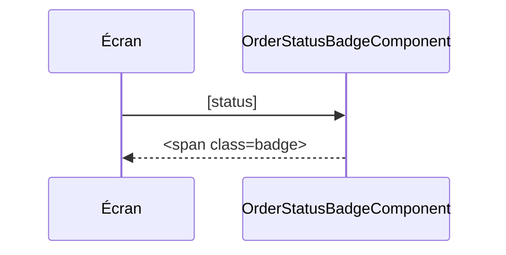

# OrderStatusBadgeComponent
`ui.order-status-badge` · type: ui · last updated: 2026-09-16 · commit: e40e7e1

## Summary

Badge qui affiche le statut d'une commande, partagé par la liste et le détail.

## Trigger

| Element | Value |
|---|---|
| Entry point | `order-status-badge` (component) |
| Selector | `app-order-status-badge` |
| Security | — |
| Preconditions | — |

## Journey

## Decisions

—

## Data

Aucune : reçoit le statut en entrée.

## Cross-cutting mechanisms

Aucun.

## Points of attention

Le statut est affiché brut, sans traduction.

## Related workflows

—

## History

| Date | Commit | Change |
|---|---|---|
| 2026-09-16 | e40e7e1 | rédaction initiale |
