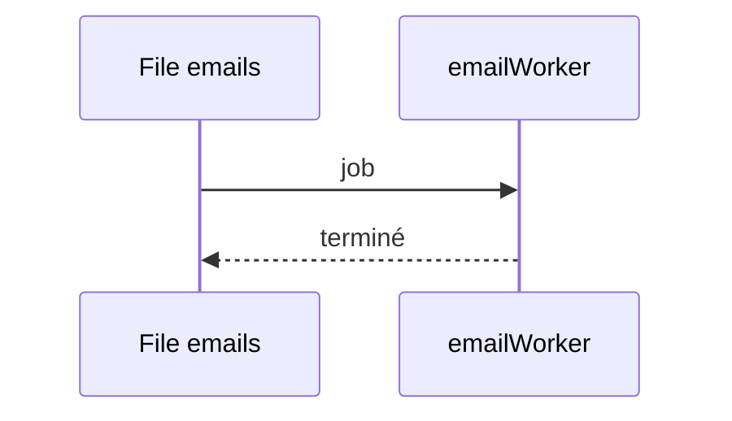

# emails (BullMQ)
`async.emails` · type: async · last updated: 2026-09-16 · commit: b3f961c

## Summary

Traite la file BullMQ `emails`.

## Trigger

| Element | Value |
|---|---|
| Entry point | `emails` (worker) |
| Security | — |
| Preconditions | Un Redis joignable. |

## Journey

## Decisions

—

## Data

Aucune.

## Cross-cutting mechanisms

Aucun.

## Points of attention

Le worker démarre au chargement du module.

## Related workflows

—

## History

| Date | Commit | Change |
|---|---|---|
| 2026-09-16 | b3f961c | rédaction initiale |
