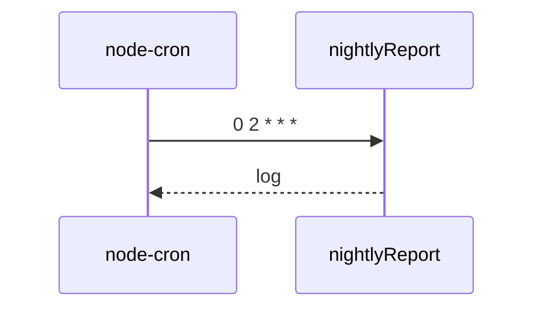

# nightly-report (0 2 * * *)
`async.nightly-report` · type: async · last updated: 2026-09-16 · commit: b3f961c

## Summary

Compte les commandes chaque nuit à 2 h.

## Trigger

| Element | Value |
|---|---|
| Entry point | `nightly-report` (scheduled) |
| Schedule | `0 2 * * *` |
| Security | — |
| Preconditions | Le module est chargé par le processus. |

## Journey

## Decisions

—

## Data

Lit les commandes.

## Cross-cutting mechanisms

Aucun.

## Points of attention

Sans chargement du module, rien ne se planifie.

## Related workflows

—

## History

| Date | Commit | Change |
|---|---|---|
| 2026-09-16 | b3f961c | rédaction initiale |
