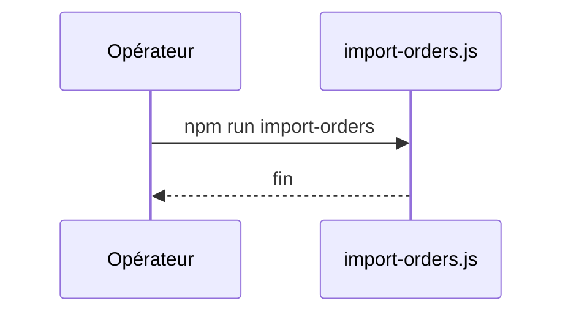

# import-orders
`command.import-orders` · type: commands · last updated: 2026-09-16 · commit: b3f961c

## Summary

Importe une commande d'exemple.

## Trigger

| Element | Value |
|---|---|
| Entry point | `import-orders` (command) |
| Security | — |
| Preconditions | — |

## Journey

## Decisions

—

## Data

Écrit une commande en mémoire.

## Cross-cutting mechanisms

Aucun.

## Points of attention

L'import se perd à la fin du processus.

## Related workflows

—

## History

| Date | Commit | Change |
|---|---|---|
| 2026-09-16 | b3f961c | rédaction initiale |
