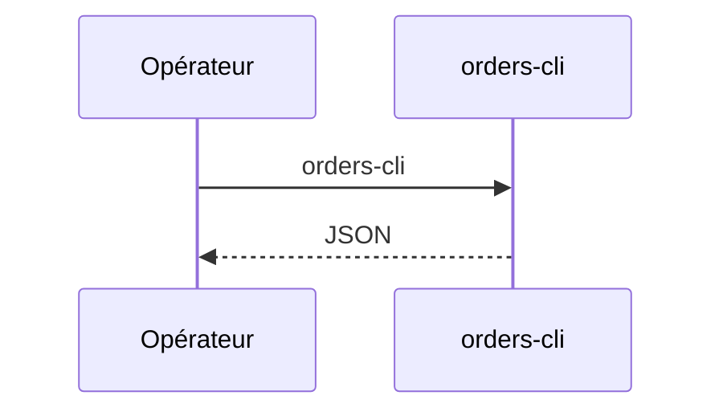

# orders-cli
`command.orders-cli` · type: commands · last updated: 2026-09-16 · commit: b3f961c

## Summary

Affiche les commandes en JSON, depuis la ligne de commande.

## Trigger

| Element | Value |
|---|---|
| Entry point | `orders-cli` (command) |
| Security | — |
| Preconditions | — |

## Journey

## Decisions

—

## Data

Lit les commandes du processus, donc aucune.

## Cross-cutting mechanisms

Aucun.

## Points of attention

Un nouveau processus n'a aucune commande en mémoire.

## Related workflows

—

## History

| Date | Commit | Change |
|---|---|---|
| 2026-09-16 | b3f961c | rédaction initiale |
