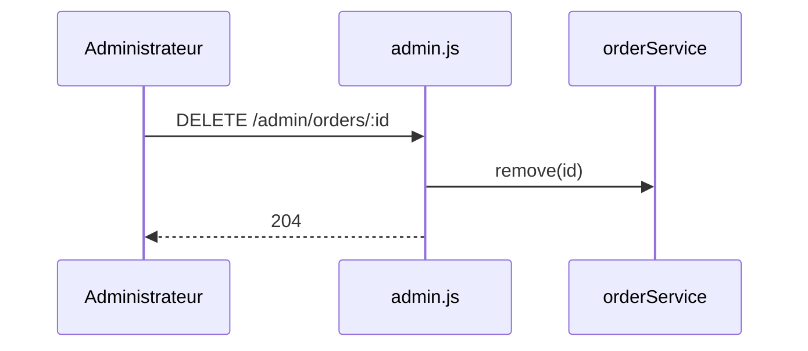

# DELETE /admin/orders/:id
`route.delete.admin.orders.id` · type: routes · last updated: 2026-09-16 · commit: b3f961c

## Summary

Supprime une commande, réservé à l'administration.

## Trigger

| Element | Value |
|---|---|
| Entry point | `DELETE /admin/orders/:id` (`delete.admin.orders.id`) |
| Security | `requireAuth`, `requireAdmin` |
| Preconditions | `requireAuth` au montage de `/admin`, puis `requireAdmin` sur la route. |

## Journey

## Decisions

—

## Data

Supprime une commande.

## Cross-cutting mechanisms

Deux middlewares : l'un hérité du montage, l'autre de la route.

## Points of attention

Un identifiant inconnu supprime le dernier élément : `findIndex` rend -1.

## Related workflows

—

## History

| Date | Commit | Change |
|---|---|---|
| 2026-09-16 | b3f961c | rédaction initiale |
