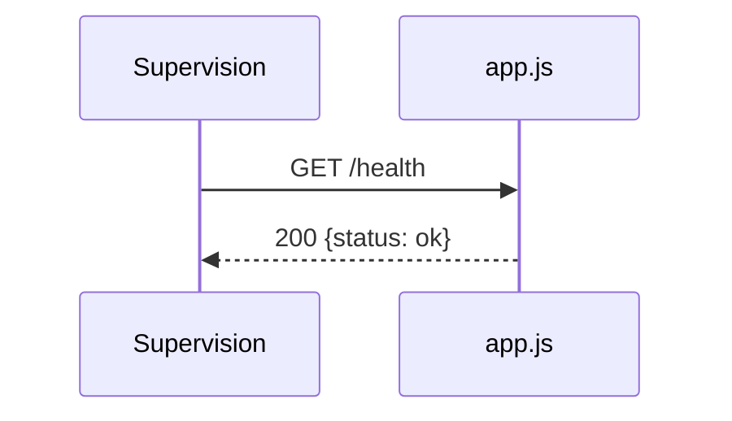

# GET /health
`route.get.health` · type: routes · last updated: 2026-09-16 · commit: b3f961c

## Summary

Signale que le processus répond.

## Trigger

| Element | Value |
|---|---|
| Entry point | `GET /health` (`get.health`) |
| Security | — |
| Preconditions | — |

## Journey

## Decisions

—

## Data

Aucune.

## Cross-cutting mechanisms

Déclarée sur l'application, hors de tout routeur.

## Points of attention

Ne vérifie aucune dépendance.

## Related workflows

—

## History

| Date | Commit | Change |
|---|---|---|
| 2026-09-16 | b3f961c | rédaction initiale |
