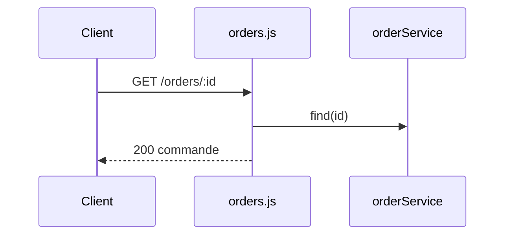

# GET /orders/:id
`route.get.orders.id` · type: routes · last updated: 2026-09-16 · commit: b3f961c

## Summary

Rend une commande par son identifiant.

## Trigger

| Element | Value |
|---|---|
| Entry point | `GET /orders/:id` (`get.orders.id`) |
| Security | — |
| Preconditions | — |

## Journey

## Decisions

—

## Data

Lit une commande.

## Cross-cutting mechanisms

Aucun.

## Points of attention

Un identifiant inconnu répond 200 avec un corps vide, pas 404.

## Related workflows

—

## History

| Date | Commit | Change |
|---|---|---|
| 2026-09-16 | b3f961c | rédaction initiale |
