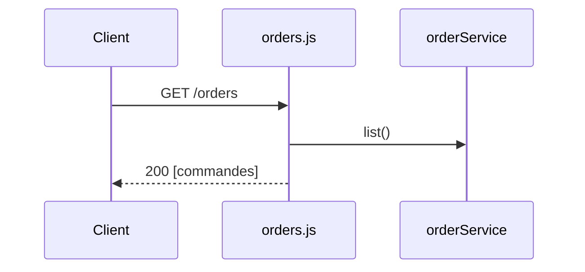

# GET /orders
`route.get.orders` · type: routes · last updated: 2026-09-16 · commit: b3f961c

## Summary

Liste les commandes en JSON.

## Trigger

| Element | Value |
|---|---|
| Entry point | `GET /orders` (`get.orders`) |
| Security | — |
| Preconditions | — |

## Journey

## Decisions

—

## Data

Lit les commandes en mémoire.

## Cross-cutting mechanisms

`express.json()` sur toute l'application.

## Points of attention

Les commandes vivent en mémoire : un redémarrage les perd.

## Related workflows

—

## History

| Date | Commit | Change |
|---|---|---|
| 2026-09-16 | b3f961c | rédaction initiale |
