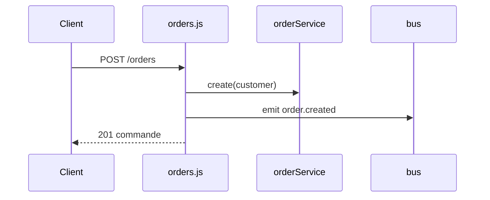

# POST /orders
`route.post.orders` · type: routes · last updated: 2026-09-16 · commit: b3f961c

## Summary

Crée une commande et annonce `order.created`.

## Trigger

| Element | Value |
|---|---|
| Entry point | `POST /orders` (`post.orders`) |
| Security | `requireAuth` |
| Preconditions | Un en-tête `Authorization` (`requireAuth`). |

## Journey

## Decisions

—

## Data

Écrit une commande en mémoire.

## Cross-cutting mechanisms

`notifyWarehouse` écoute `order.created` et s'exécute pendant la requête.

## Points of attention

`requireAuth` vérifie la présence de l'en-tête, pas sa valeur.

## Related workflows

—

## History

| Date | Commit | Change |
|---|---|---|
| 2026-09-16 | b3f961c | rédaction initiale |
