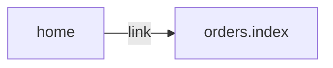

# GET /
`route.home` · type: routes · last updated: 2026-09-16 · commit: a8254ce

## Summary

—

## Trigger

| Element | Value |
|---|---|
| Entry point | `GET /` (`home`) |
| Security | — |
| Preconditions | — |

## Journey

—

## Decisions

**Navigation**

<!-- Above: drawn by DevTools from the code. Below: written by Claude. -->

## Data

—

## Cross-cutting mechanisms

—

## Points of attention

—

## Related workflows

- [`route.orders.index`](orders.index.md) — navigation

## History

| Date | Commit | Change |
|---|---|---|
| 2026-09-16 | a8254ce | initial |
