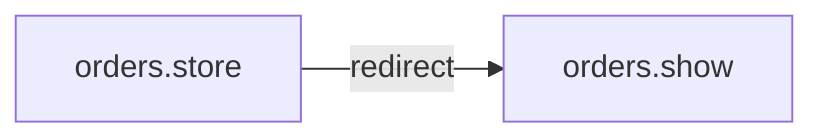

# POST /orders
`route.orders.store` · type: routes · last updated: 2026-09-16 · commit: a8254ce

## Summary

—

## Trigger

| Element | Value |
|---|---|
| Entry point | `POST /orders` (`orders.store`) |
| Security | `auth`, `can:create,App\Models\Order` |
| Preconditions | — |

## Journey

—

## Decisions

**Navigation**

<!-- Above: drawn by DevTools from the code. Below: written by Claude. -->

## Data

—

## Cross-cutting mechanisms

| Mechanism | Event | Priority | Decides |
|---|---|---|---|
| `App\Listeners\NotifyWarehouse` | `App\Events\OrderPlaced` | — | — |

## Points of attention

—

## Related workflows

- [`route.orders.show`](orders.show.md) — navigation

## History

| Date | Commit | Change |
|---|---|---|
| 2026-09-16 | a8254ce | initial |
