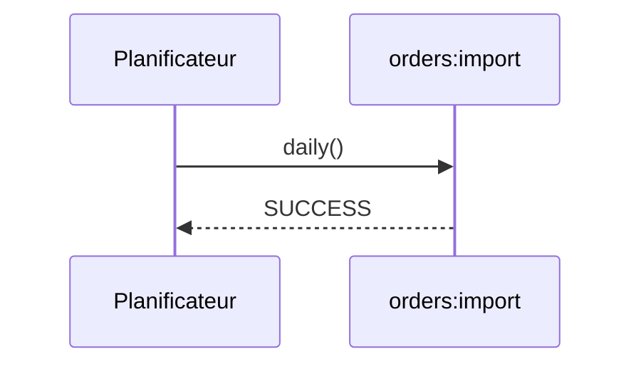

# orders:import (daily)
`async.orders-import` · type: async · last updated: 2026-09-16 · commit: a8254ce

## Summary

Lance `orders:import` chaque jour, par le planificateur de `routes/console.php`.

## Trigger

| Element | Value |
|---|---|
| Entry point | `orders:import` (scheduled) |
| Schedule | `daily` |
| Security | — |
| Preconditions | Un cron lance `schedule:run` chaque minute. |

## Journey

## Decisions

—

## Data

Celles de `orders:import`.

## Cross-cutting mechanisms

Aucun.

## Points of attention

Sans cron sur le serveur, la tâche ne s'exécute jamais, sans erreur.

## Related workflows

- [`command.orders.import`](../commands/orders.import.md) — depends on

## History

| Date | Commit | Change |
|---|---|---|
| 2026-09-16 | a8254ce | rédaction initiale |
