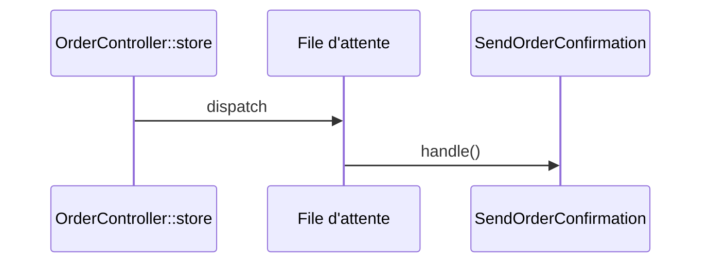

# SendOrderConfirmation
`async.send-order-confirmation` · type: async · last updated: 2026-09-16 · commit: a8254ce

## Summary

Envoie la confirmation d'une commande, en file d'attente.

## Trigger

| Element | Value |
|---|---|
| Entry point | `App\Jobs\SendOrderConfirmation` (job) |
| Security | — |
| Preconditions | Un worker `queue:work` tourne. |

## Journey

## Decisions

—

## Data

Recharge l'`Order` sérialisée par son identifiant.

## Cross-cutting mechanisms

Aucun.

## Points of attention

`handle()` est vide : aucune confirmation n'est encore envoyée.

## Related workflows

—

## History

| Date | Commit | Change |
|---|---|---|
| 2026-09-16 | a8254ce | rédaction initiale |
