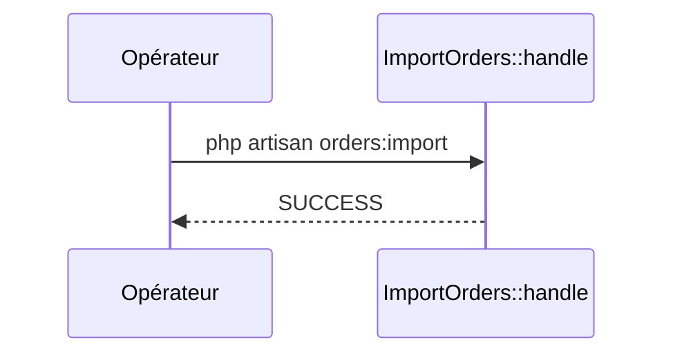

# orders:import
`command.orders.import` · type: commands · last updated: 2026-09-16 · commit: a8254ce

## Summary

Importe les commandes d'un export CSV ; le fichier est facultatif.

## Trigger

| Element | Value |
|---|---|
| Entry point | `orders:import` (command) |
| Security | — |
| Preconditions | — |

## Journey

## Decisions

—

## Data

Compte les `Order` existantes ; n'écrit encore rien.

## Cross-cutting mechanisms

Aucun.

## Points of attention

L'import n'est pas écrit : la commande se contente de compter les commandes.

## Related workflows

—

## History

| Date | Commit | Change |
|---|---|---|
| 2026-09-16 | a8254ce | rédaction initiale |
