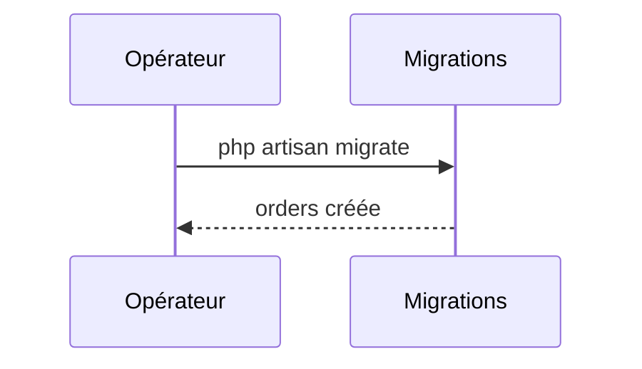

# Migrations
`data.migrations` · type: data · last updated: 2026-09-16 · commit: a8254ce

## Summary

Crée la table `orders` : identifiant, référence de 32 caractères, horodatages.

## Trigger

| Element | Value |
|---|---|
| Entry point | `migrations` (migration) |
| Security | — |
| Preconditions | — |

## Journey

## Decisions

—

## Data

Schéma de `orders`.

## Cross-cutting mechanisms

Aucun.

## Points of attention

Aucune méthode `down()` : la migration ne se défait pas.

## Related workflows

—

## History

| Date | Commit | Change |
|---|---|---|
| 2026-09-16 | a8254ce | rédaction initiale |
