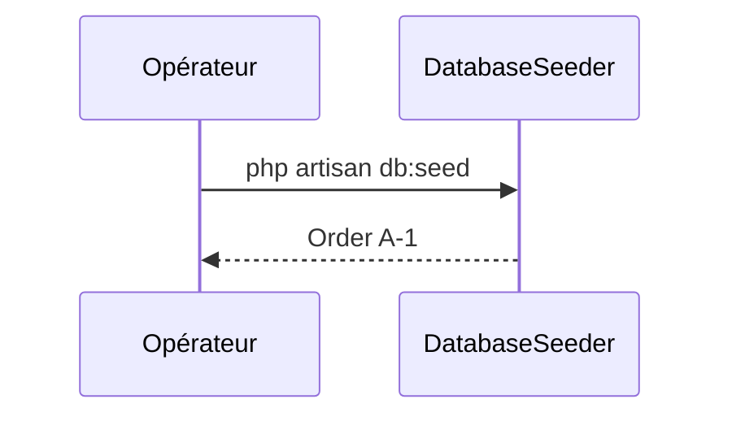

# Seeders
`data.seeders` · type: data · last updated: 2026-09-16 · commit: a8254ce

## Summary

Peuple la base avec une commande d'exemple, `A-1`.

## Trigger

| Element | Value |
|---|---|
| Entry point | `seeders` (seeder) |
| Security | — |
| Preconditions | Les migrations sont passées. |

## Journey

## Decisions

—

## Data

Écrit une `Order`.

## Cross-cutting mechanisms

Aucun.

## Points of attention

Relancé, il crée une seconde commande `A-1`.

## Related workflows

—

## History

| Date | Commit | Change |
|---|---|---|
| 2026-09-16 | a8254ce | rédaction initiale |
