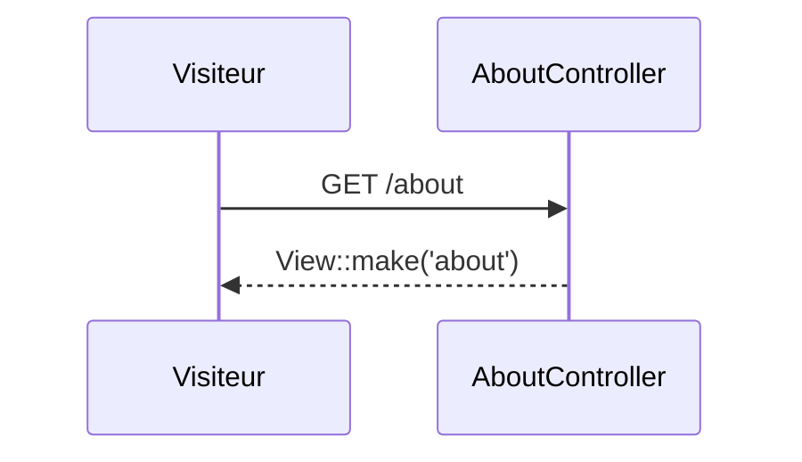

# GET /about
`route.get.about` · type: routes · last updated: 2026-09-16 · commit: a8254ce

## Summary

Page « À propos », statique, rendue par un contrôleur invocable.

## Trigger

| Element | Value |
|---|---|
| Entry point | `GET /about` (`get.about`) |
| Security | — |
| Preconditions | — |

## Journey

## Decisions

—

## Data

Aucune.

## Cross-cutting mechanisms

Groupe `web`.

## Points of attention

La route n'a pas de nom : son identifiant vient de sa méthode et de son URI, et changera avec elle.

## Related workflows

—

## History

| Date | Commit | Change |
|---|---|---|
| 2026-09-16 | a8254ce | rédaction initiale |
