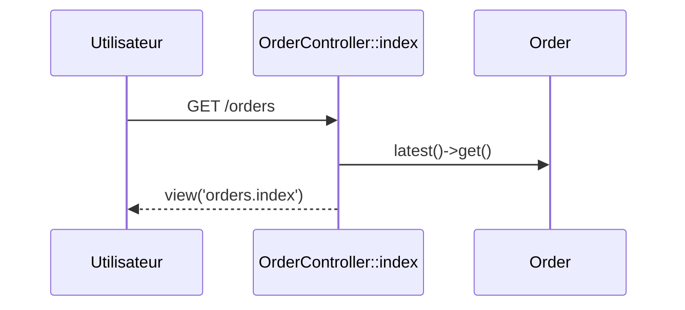
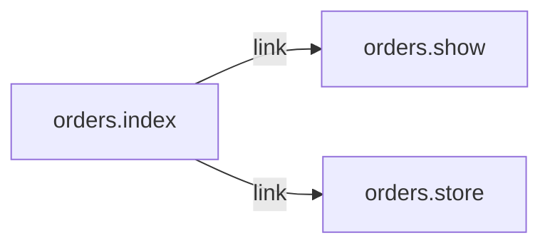

# GET /orders
`route.orders.index` · type: routes · last updated: 2026-09-16 · commit: a8254ce

## Summary

Liste des commandes, des plus récentes aux plus anciennes, avec un formulaire de création.

## Trigger

| Element | Value |
|---|---|
| Entry point | `GET /orders` (`orders.index`) |
| Security | `auth` |
| Preconditions | Être connecté (`auth`). |

## Journey

## Decisions

**Navigation**

<!-- Above: drawn by DevTools from the code. Below: written by Claude. -->

## Data

Lit toutes les `Order`, sans pagination.

## Cross-cutting mechanisms

`auth` redirige un visiteur non connecté vers la connexion.

## Points of attention

Sans pagination, la page grossit avec la table `orders`.

## Related workflows

- [`route.orders.show`](orders.show.md) — navigation
- [`route.orders.store`](orders.store.md) — navigation

## History

| Date | Commit | Change |
|---|---|---|
| 2026-09-16 | a8254ce | rédaction initiale |
