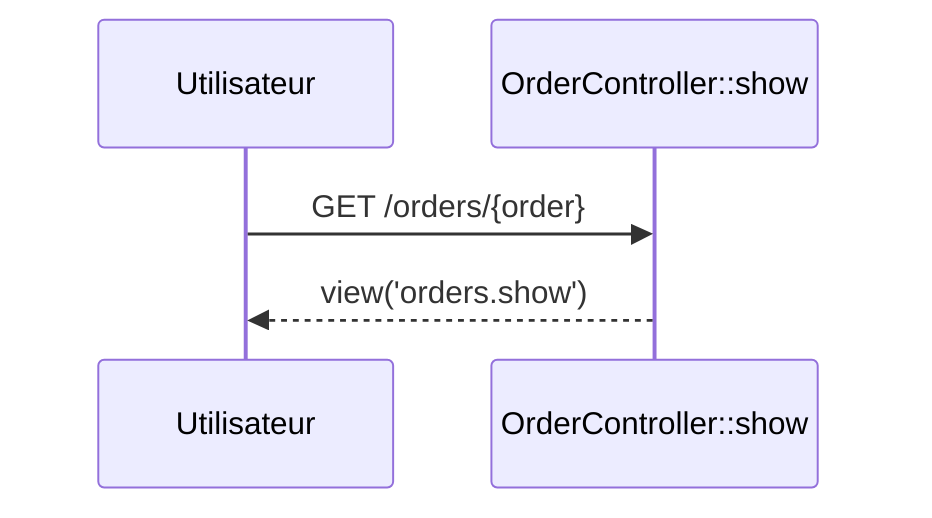

# GET /orders/{order}
`route.orders.show` · type: routes · last updated: 2026-09-16 · commit: a8254ce

## Summary

Affiche une commande, retrouvée par sa clé grâce à la liaison de modèle de la route.

## Trigger

| Element | Value |
|---|---|
| Entry point | `GET /orders/{order}` (`orders.show`) |
| Security | `auth`, `can:view,order` |
| Preconditions | Être connecté et autorisé par `OrderPolicy::view`. |

## Journey

## Decisions

—

## Data

Lit une `Order`.

## Cross-cutting mechanisms

`can:view,order` consulte `OrderPolicy::view` avec la commande liée.

## Points of attention

Une clé inconnue répond 404 avant même le contrôleur.

## Related workflows

—

## History

| Date | Commit | Change |
|---|---|---|
| 2026-09-16 | a8254ce | rédaction initiale |
