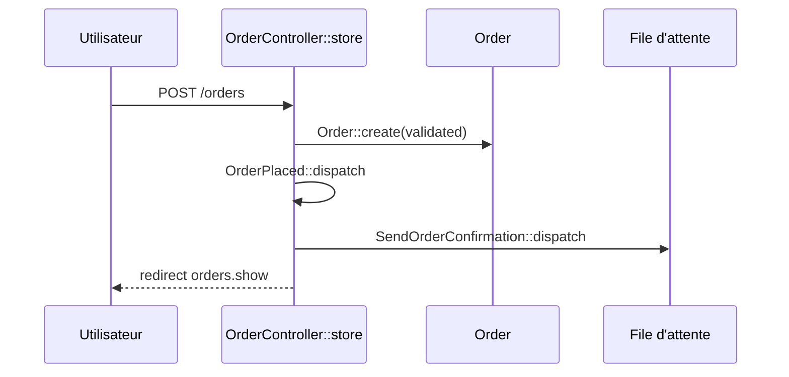
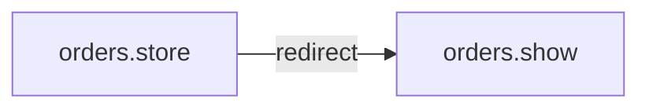

# POST /orders
`route.orders.store` · type: routes · last updated: 2026-09-16 · commit: a8254ce

## Summary

Crée une commande à partir de sa référence, annonce `OrderPlaced` et met en file l'envoi de la confirmation.

## Trigger

| Element | Value |
|---|---|
| Entry point | `POST /orders` (`orders.store`) |
| Security | `auth`, `can:create,App\Models\Order` |
| Preconditions | Être connecté et autorisé par `OrderPolicy::create`. |

## Journey

## Decisions

**Navigation**

<!-- Above: drawn by DevTools from the code. Below: written by Claude. -->

## Data

Écrit une `Order` ; la référence est obligatoire, 32 caractères au plus.

## Cross-cutting mechanisms

`NotifyWarehouse` écoute `OrderPlaced` et s'exécute pendant la requête, avant la redirection.

## Points of attention

Une référence invalide renvoie au formulaire avec les erreurs, sans rien écrire.

## Related workflows

- [`route.orders.show`](orders.show.md) — navigation

## History

| Date | Commit | Change |
|---|---|---|
| 2026-09-16 | a8254ce | rédaction initiale |
