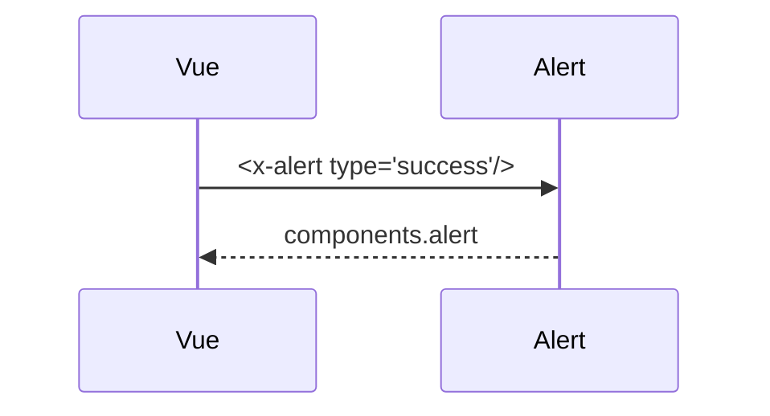

# Alert
`ui.alert` · type: ui · last updated: 2026-09-16 · commit: a8254ce

## Summary

Composant Blade d'alerte, typé (`info` par défaut).

## Trigger

| Element | Value |
|---|---|
| Entry point | `App\View\Components\Alert` (component) |
| Live | `false` |
| Security | — |
| Preconditions | — |

## Journey

## Decisions

—

## Data

Aucune.

## Cross-cutting mechanisms

Aucun.

## Points of attention

Le contenu vient du slot : une alerte sans contenu reste vide.

## Related workflows

—

## History

| Date | Commit | Change |
|---|---|---|
| 2026-09-16 | a8254ce | rédaction initiale |
