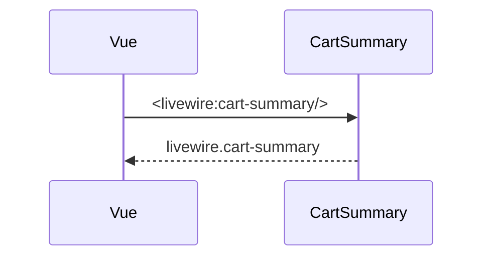

# CartSummary
`ui.cart-summary` · type: ui · last updated: 2026-09-16 · commit: a8254ce

## Summary

Composant Livewire qui affiche le nombre d'articles du panier.

## Trigger

| Element | Value |
|---|---|
| Entry point | `App\Livewire\CartSummary` (component) |
| Live | `true` |
| Security | — |
| Preconditions | — |

## Journey

## Decisions

—

## Data

Aucune : `items` vaut 0.

## Cross-cutting mechanisms

Les requêtes Livewire passent par la route `livewire/update` du paquet.

## Points of attention

Le compteur ne lit aucun panier réel.

## Related workflows

—

## History

| Date | Commit | Change |
|---|---|---|
| 2026-09-16 | a8254ce | rédaction initiale |
